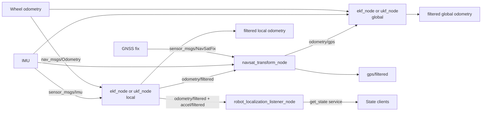

# robot_localization

## Table of Contents

- [Overview](#overview)
- [Installation & Build](#installation--build)
- [Nodes / Executables](#nodes--executables)
- [Launch Files](#launch-files)
- [Interfaces](#interfaces)
- [Configuration](#configuration)
- [Testing](#testing)
- [Known Issues](#known-issues)
- [Glossary](#glossary)

## Overview

`robot_localization` provides nonlinear state estimation for ROS 2. Its EKF and UKF nodes fuse any contiguous sequence of configured odometry, pose, twist, and IMU inputs into a 15-state estimate; `navsat_transform_node` converts GNSS fixes into the estimator's Cartesian world frame and can convert filtered odometry back to latitude/longitude; and `robot_localization_listener_node` buffers synchronized estimates and serves a requested state at a requested time/frame. The DHAS-specific files configure the common dual-filter pattern: a continuous `odom`-frame filter, a globally corrected `map`-frame filter, and a GNSS transform between them.

| Property | Value |
|---|---|
| Package/version | `robot_localization` 3.5.4 (`package.xml:3-4`) |
| Build type | `ament_cmake` (`package.xml:47-49`) |
| Language | C++17 on non-Windows platforms (`CMakeLists.txt:4-6`) |
| ROS distro | ROS 2 Humble |
| State | `[x, y, z, roll, pitch, yaw, vx, vy, vz, vroll, vpitch, vyaw, ax, ay, az]` (`srv/GetState.srv:4-8`) |
| Exported C++ library | `rl_lib`, headers under `include/robot_localization/` (`CMakeLists.txt:48-71, 338-352`) |
| Installed executables | `ekf_node`, `ukf_node`, `navsat_transform_node`, `robot_localization_listener_node` (`CMakeLists.txt:74-91, 329-336`) |
| Installed resources | `params/`, `launch/`, public headers, and—when testing is enabled—the entire `test/` directory (`CMakeLists.txt:302-327, 338-348`) |
| Generated code | C++ type support for six package-local services (`CMakeLists.txt:35-46`) |
| Components | No `rclcpp_components` registration or plugin export; none of the executables is loadable as a ROS component. `rl_lib` can still be linked by C++ code. |

### Dependencies

“External” means outside this package/workspace package; no dependency declared in `package.xml` is another package in this workspace checkout.

| Name | Declared type | Internal? | Purpose |
|---|---|---:|---|
| `ament_cmake` | build tool | No | CMake/ament build |
| `builtin_interfaces` | build tool, test | No | `Time` in `GetState.srv` |
| `rosidl_default_generators` | build tool | No | Service code generation |
| `libboost-dev` | build, build export | No | Circular buffer and C++ utilities |
| `eigen` | depend | No | State vectors, matrices, transforms |
| `geographic_msgs` | depend | No | Datum and geographic service fields |
| `geometry_msgs` | depend | No | Pose, twist, acceleration, points, transforms |
| `diagnostic_msgs` | depend | No | Filter diagnostics |
| `diagnostic_updater` | depend | No | `/diagnostics` reporting |
| `geographiclib` | depend | No | Local Cartesian/geodetic conversion |
| `message_filters` | depend | No | Exact-time odometry/acceleration synchronization |
| `nav_msgs` | depend | No | Odometry input/output |
| `angles` | depend | No | Angle normalization |
| `rclcpp` | build, exec | No | ROS 2 C++ client library |
| `rmw_implementation` | build, exec | No | Runtime middleware implementation |
| `sensor_msgs` | depend | No | IMU and `NavSatFix` |
| `std_msgs` | depend | No | Standard message support used by the library build |
| `std_srvs` | depend | No | Empty `enable` service |
| `tf2`, `tf2_eigen`, `tf2_geometry_msgs`, `tf2_ros` | depend | No | Transform lookup, conversion, and broadcasting |
| `yaml_cpp_vendor` | depend | No | TF-tree YAML parsing in the listener |
| `rosidl_default_runtime` | exec/export | No | Generated service runtime |
| `ament_cmake_gtest` | test | No | GoogleTest integration |
| `ament_lint_auto`, `ament_lint_common` | test | No | Declared lint dependencies |
| `launch_ros`, `launch_testing_ament_cmake` | test | No | Node/launch integration tests |

The CMake test block also directly finds `ament_cmake_cppcheck`, `ament_cmake_cpplint`, `ament_cmake_lint_cmake`, and `ament_cmake_uncrustify` (`CMakeLists.txt:116-122`); these are not individually declared in `package.xml`.

### Package layout

- `src/ekf.cpp`, `src/ukf.cpp`, and `src/filter_base.cpp` implement the two nonlinear filters and common predict/correct state machinery.
- `src/ros_filter.cpp` is the shared ROS-facing wrapper used by both state-estimation executables.
- `src/navsat_transform.cpp` implements geodetic/Cartesian conversion and GNSS integration.
- `src/robot_localization_estimator.cpp` and `src/ros_robot_localization_listener.cpp` implement buffered time interpolation/extrapolation and frame conversion.
- `src/filter_utilities.cpp`, `src/ros_filter_utilities.cpp`, and the corresponding public headers contain shared math, parameter, and transform helpers.
- `doc/` contains the Sphinx manual, diagrams, and the six-page estimator paper; it is documentation input and is not installed by this CMake project.

## Installation & Build

From the workspace root:

```bash
source /opt/ros/<distro>/setup.bash
rosdep install --from-paths src --ignore-src -r -y
colcon build --packages-select robot_localization
source install/setup.bash
```

CMake defaults to `RelWithDebInfo` when no build type is supplied (`CMakeLists.txt:12-16`). To choose one explicitly:

```bash
colcon build --packages-select robot_localization \
  --cmake-args -DCMAKE_BUILD_TYPE=RelWithDebInfo
```

Non-standard build details:

- `rosidl_generate_interfaces()` generates C++ support for all files in `srv/`, including interface linter tests (`CMakeLists.txt:35-46`).
- `rl_lib` links the generated C++ type-support target plus GeographicLib and Eigen (`CMakeLists.txt:61-71, 93-108`).
- GeographicLib discovery prepends the fixed path `/usr/share/cmake/geographiclib/` (`CMakeLists.txt:29-31`). A non-Debian installation may require `-DCMAKE_MODULE_PATH=...` or a CMake change.
- Public headers, `rl_lib`, and the generated interface runtime are exported (`CMakeLists.txt:338-352`). There are no custom code-generation steps beyond ROSIDL.
- System/runtime requirements are represented by rosdep keys (`libboost-dev`, `eigen`, `geographiclib`); no closed SDK is used. Launch-time `rviz2`, `ament_index_python`, `launch`, and `launch_ros` usage is not fully represented in `package.xml`; see [Known Issues](#known-issues).

## Nodes / Executables

All four executables call `rclcpp::spin`, so application callbacks use the standard single-threaded executor. TF listeners may maintain their own internal listener machinery, but the package creates no callback groups or `MultiThreadedExecutor`. None is a lifecycle node, action endpoint, or registered composable component.



Topic names above are executable defaults; launch remappings can change them. The listener's literal defaults differ from the filter outputs, as detailed below.

### `ekf_node`

- **Source:** `src/ekf_node.cpp`; ROS wrapper in `src/ros_filter.cpp`; EKF algorithm in `src/ekf.cpp`.
- **Node name:** `ekf_filter_node` (`src/ekf_node.cpp:45-50`); default namespace `/`.
- **Behavior:** fuses configured measurements with an extended Kalman filter, publishes at `frequency`, and optionally broadcasts either `odom -> base_link` or `map -> odom` according to `world_frame` (`src/ros_filter.cpp:792-828, 2020-2024, 2094-2151`).
- **Threading/lifecycle/composability:** single-threaded `rclcpp::spin`; ordinary node; no component registration.

### `ukf_node`

- **Source:** `src/ukf_node.cpp`; ROS wrapper in `src/ros_filter.cpp`; UKF algorithm in `src/ukf.cpp`.
- **Node name:** `ukf_filter_node` (`src/ukf_node.cpp:45-54`); default namespace `/`.
- **Behavior:** same ROS API and periodic behavior as `ekf_node`, using an unscented Kalman filter. It additionally declares `alpha=0.001`, `kappa=0.0`, and `beta=2.0` and passes them to the UKF before initialization (`src/ukf_node.cpp:49-53`).
- **Threading/lifecycle/composability:** single-threaded `rclcpp::spin`; ordinary node; no component registration.

#### EKF/UKF publishers

| Topic | Type | QoS | Rate/condition |
|---|---|---|---|
| `odometry/filtered` | `nav_msgs/msg/Odometry` | Keep-last 10, reliable, volatile; standard policy overrides enabled | Timer rate `frequency` (default 30 Hz), after initialization (`src/ros_filter.cpp:1990-2024, 2161-2169`) |
| `accel/filtered` | `geometry_msgs/msg/AccelWithCovarianceStamped` | Keep-last 10, reliable, volatile; standard policy overrides enabled | Timer rate `frequency` when `publish_acceleration=true` (`src/ros_filter.cpp:2013-2018, 2177-2182`) |
| `/tf` | `tf2_msgs/msg/TFMessage` via `TransformBroadcaster` | Broadcaster-defined QoS | Timer rate when `publish_tf=true`; transform is `world_frame -> base_link_frame_output`, or `map_frame -> odom_frame` when `world_frame=map_frame` (`src/ros_filter.cpp:2094-2151`) |
| `/diagnostics` | `diagnostic_msgs/msg/DiagnosticArray` via `diagnostic_updater` | Updater-defined QoS **[UNCLEAR — verify in the installed `diagnostic_updater`]** | When `print_diagnostics=true`; frequency target is `frequency ± 2 Hz` (`src/ros_filter.cpp:1973-1998, 2171-2195`) |

#### EKF/UKF subscribers

Configured sensor indices must be contiguous from zero; scanning stops at the first missing index (`src/ros_filter.cpp:1087-1108`).

| Topic | Type | QoS | Callback behavior |
|---|---|---|---|
| value of `odomN` | `nav_msgs/msg/Odometry` | `SensorDataQoS`: keep-last `odomN_queue_size` (10), best-effort, volatile | Splits pose and twist, transforms them to configured frames, applies update masks/rejection thresholds, and queues enabled state variables (`src/ros_filter.cpp:1091-1183, 1817-1868`) |
| value of `poseN` | `geometry_msgs/msg/PoseWithCovarianceStamped` | `SensorDataQoS`: keep-last `poseN_queue_size` (10), best-effort, volatile | Transforms/normalizes pose, optionally makes it relative or differential, rejects old/outlier samples, then queues it (`src/ros_filter.cpp:1245-1320, 1871-1968`) |
| value of `twistN` | `geometry_msgs/msg/TwistWithCovarianceStamped` | `SensorDataQoS`: keep-last `twistN_queue_size` (10), best-effort, volatile | Transforms velocity, applies the update mask/threshold, and queues it (`src/ros_filter.cpp:1362-1415`) |
| value of `imuN` | `sensor_msgs/msg/Imu` | `SensorDataQoS`: keep-last `imuN_queue_size` (10), best-effort, volatile | Separately processes orientation, angular velocity, and linear acceleration; optionally removes gravity (`src/ros_filter.cpp:1443-1622`) |
| `set_pose` | `geometry_msgs/msg/PoseWithCovarianceStamped` | Keep-last 1, reliable, volatile | Clears queued/history state and resets the filter pose; samples at/before the reset time are ignored (`src/ros_filter.cpp:1056-1060, 1819-1837, 2200-2240`) |
| `cmd_vel` | `geometry_msgs/msg/Twist` | Keep-last 1, reliable, volatile | Used as prediction control when `use_control=true` and `stamped_control=false` (`src/ros_filter.cpp:1697-1705`) |
| `cmd_vel` | `geometry_msgs/msg/TwistStamped` | Keep-last 1, reliable, volatile | Alternative selected when both `use_control=true` and `stamped_control=true` (`src/ros_filter.cpp:1697-1705`) |

#### EKF/UKF services and actions

| Name | Type | Role | Behavior |
|---|---|---|---|
| `set_pose` | `robot_localization/srv/SetPose` | Server | Same reset operation as the `set_pose` topic (`src/ros_filter.cpp:1062-1067`) |
| `enable` | `std_srvs/srv/Empty` | Server | Enables a filter created with `disabled_at_startup=true` (`src/ros_filter.cpp:1069-1074, 2030-2036`) |
| `toggle` | `robot_localization/srv/ToggleFilterProcessing` | Server | Starts/stops processing new measurements while periodic publishing continues; returns the new status (`src/ros_filter.cpp:1076-1082, 2041-2051`) |

There are no service clients and no action servers/clients.

#### EKF/UKF parameters

Parameters are declared without read-only descriptors. They are read into member state at startup and there is no on-set callback, so changing them through the parameter service is **not** a supported live reconfiguration path unless the process is restarted.

| Parameter | Type | Default | Meaning |
|---|---|---:|---|
| `frequency` | double | `30.0` | Periodic predict/publish rate in Hz |
| `sensor_timeout` | double | `1/frequency` | Time without measurements before prediction-only updates |
| `two_d_mode` | bool | `false` | Force Z, roll, pitch, related velocities, and Z acceleration to zero |
| `map_frame`, `odom_frame`, `base_link_frame` | string | `map`, `odom`, `base_link` | REP-105 frame IDs |
| `base_link_frame_output` | string | `base_link_frame` | Child frame used only for output |
| `world_frame` | string | `odom_frame` | Output/world frame; selects local vs global TF behavior |
| `tf_prefix` | string | not set | Prefix applied to all configured frame IDs |
| `publish_tf` | bool | `true` | Broadcast the computed transform |
| `publish_acceleration` | bool | `false` | Advertise/publish `accel/filtered` |
| `permit_corrected_publication` | bool | `false` | Allow republishing a corrected state after lagged data |
| `transform_time_offset` | double | `0.0` | Seconds added to published TF timestamps |
| `transform_timeout` | double | `0.0` | TF lookup timeout in seconds |
| `predict_to_current_time` | bool | `false` | Predict the output from last measurement time to current time |
| `smooth_lagged_data` | bool | `false` | Revert/reprocess state history for late measurements |
| `history_length` | double | `0.0` | Seconds of state/measurement history retained for smoothing |
| `reset_on_time_jump` | bool | `false` | Reset when ROS time jumps backward |
| `print_diagnostics` | bool | `false` | Enable diagnostic aggregation/publication |
| `debug` | bool | `false` | Enable verbose filter debug stream |
| `debug_out_file` | string | `robot_localization_debug.txt` | Debug output path; declared only when `debug=true` |
| `gravitational_acceleration` | double | filter constant (normally `9.80665`) | Gravity magnitude used for IMU compensation (`src/ros_filter.cpp:764-767`) |
| `dynamic_process_noise_covariance` | bool | `false` | Scale process noise dynamically with vehicle motion |
| `process_noise_covariance` | double[225] | filter's built-in 15×15 matrix | Prediction process-noise covariance; supplied array must have 225 elements |
| `initial_estimate_covariance` | double[225] | filter's built-in 15×15 matrix | Initial estimate-error covariance; supplied array must have 225 elements |
| `initial_state` | double[15] | not set | Optional initial 15-state vector |
| `disabled_at_startup` | bool | `false` | Hold updates until `enable` is called |
| `use_control` | bool | `false` | Use `cmd_vel` during prediction |
| `stamped_control` | bool | `false` | Select `TwistStamped` rather than `Twist` |
| `control_timeout` | double | `0.0` in code | Maximum control age |
| `control_config` | bool[6] | required when control enabled | Enable `[vx, vy, vz, vroll, vpitch, vyaw]` control axes |
| `acceleration_limits`, `deceleration_limits` | double[6] | ones / acceleration limits | Per-axis motion limits |
| `acceleration_gains`, `deceleration_gains` | double[6] | ones / acceleration gains | Per-axis approach gains |
| `odomN`, `poseN`, `twistN`, `imuN` | string | not set | Input topic. `N` starts at 0 and must be contiguous per message family |
| `<sensor>_config` | bool[15] | all false | State-vector fields fused from that sensor |
| `odomN_differential`, `poseN_differential`, `imuN_differential` | bool | `false` | Convert pose deltas to velocity before fusion |
| `odomN_relative`, `poseN_relative`, `imuN_relative` | bool | `false` | Treat first pose as the sensor's zero point |
| `<sensor>_queue_size` | int | `10` | Sensor subscription keep-last depth |
| `odomN_pose_rejection_threshold`, `odomN_twist_rejection_threshold` | double | max double | Mahalanobis outlier thresholds |
| `poseN_rejection_threshold`, `twistN_rejection_threshold` | double | max double | Mahalanobis outlier thresholds |
| `imuN_pose_rejection_threshold`, `imuN_twist_rejection_threshold`, `imuN_linear_acceleration_rejection_threshold` | double | max double | IMU outlier thresholds |
| `imuN_remove_gravitational_acceleration` | bool | `false` | Subtract gravity using measured orientation |
| `alpha`, `kappa`, `beta` | double | `0.001`, `0.0`, `2.0` | UKF-only sigma-point parameters (`src/ukf_node.cpp:49-52`) |

`use_sim_time` is the standard `rclcpp` parameter rather than a package declaration. YAML keys ending in `_nodelay` are never read by this ROS 2 implementation.

### `navsat_transform_node`

- **Source:** `src/navsat_transform_node.cpp`, implementation `src/navsat_transform.cpp`.
- **Node name:** `navsat_transform_node` (`src/navsat_transform.cpp:60-83`); default namespace `/`.
- **Behavior:** waits for odometry, a valid GNSS fix, and heading (IMU, odometry yaw, or manual datum), computes a world↔UTM/local-ENU transform, publishes transformed GNSS odometry and optionally reverse-converted fixes (`src/navsat_transform.cpp:216-349`).
- **Threading/lifecycle/composability:** single-threaded `rclcpp::spin`; ordinary node; no component registration.

#### Publishers and subscribers

| Direction | Topic | Type | QoS | Behavior/rate |
|---|---|---|---|---|
| Subscribe | `odometry/filtered` | `nav_msgs/msg/Odometry` | `SensorDataQoS`: keep-last 1, best-effort, volatile; policy overrides enabled | Supplies world/base frames, pose, covariance, and optionally heading |
| Subscribe | `gps/fix` | `sensor_msgs/msg/NavSatFix` | Same | Accepts usable fixes and converts them to Cartesian coordinates |
| Subscribe | `imu` | `sensor_msgs/msg/Imu` | Same | Created only when both `use_odometry_yaw=false` and `wait_for_datum=false`; supplies heading |
| Publish | `odometry/gps` | `nav_msgs/msg/Odometry` | Keep-last 10, reliable, volatile; policy overrides enabled | At most one result per new fix, checked by the `frequency` timer |
| Publish | `gps/filtered` | `sensor_msgs/msg/NavSatFix` | Keep-last 10, reliable, volatile; policy overrides enabled | Created only when `publish_filtered_gps=true`; at most one result per new odometry sample |
| Publish | `/tf_static` | `tf2_msgs/msg/TFMessage` via static broadcaster | Broadcaster-defined QoS | One UTM/local-ENU transform after initialization when broadcasting is enabled |

The wall timer defaults to 10 Hz and is configured by `frequency`; construction blocks for `delay` seconds before creating it (`src/navsat_transform.cpp:91-105, 203-211`).

#### Services and actions

| Name | Type | Role | Behavior |
|---|---|---|---|
| `datum` | `robot_localization/srv/SetDatum` | Server | Sets/replaces the geographic origin and forces transform recomputation |
| `toLL` | `robot_localization/srv/ToLL` | Server | Converts a world/map point to latitude, longitude, altitude; fails until transform is ready |
| `fromLL` | `robot_localization/srv/FromLL` | Server | Converts latitude, longitude, altitude to a world/map point; fails until transform is ready |

There are no clients or action endpoints (`src/navsat_transform.cpp:140-146, 352-467`).

#### Parameters

All are writable at the ROS parameter layer. Only `magnetic_declination_radians` is handled dynamically; changing it updates the member and invalidates the transform for recomputation (`src/navsat_transform.cpp:137-138, 909-925`). Other changes require restart to affect behavior.

| Parameter | Type | Default | Meaning |
|---|---|---:|---|
| `frequency` | double | `10.0` | Transform/output polling rate in Hz |
| `delay` | double | `0.0` | Startup delay before transform calculation |
| `transform_timeout` | double | `0.0` | TF lookup timeout in seconds |
| `magnetic_declination_radians` | double | `0.0` | Magnetic-to-true-north heading correction; dynamically applied |
| `yaw_offset` | double | `0.0` | Additional IMU yaw correction; not dynamically applied despite callback presence |
| `zero_altitude` | bool | `false` | Force output altitude/Z to zero |
| `publish_filtered_gps` | bool | `true` | Enable `gps/filtered` output (note template YAML overrides this to false) |
| `use_odometry_yaw` | bool | `false` | Derive heading from odometry rather than IMU |
| `wait_for_datum` | bool | `false` | Use manual datum mode |
| `datum` | double[3] | empty | `[latitude_deg, longitude_deg, yaw_rad]`; declared only in manual datum mode |
| `use_local_cartesian` | bool | `false` | Use GeographicLib local ENU instead of UTM |
| `broadcast_utm_transform` | bool | `false` | Deprecated alias enabling Cartesian static TF |
| `broadcast_cartesian_transform` | bool | `false` | Preferred static-TF enable; declared only if deprecated enable is false |
| `broadcast_utm_transform_as_parent_frame_` | bool | `false` | Deprecated source spelling, including the trailing underscore |
| `broadcast_cartesian_transform_as_parent_frame` | bool | `false` | Make UTM/local-ENU the parent rather than child of the world frame |

### `robot_localization_listener_node`

- **Source:** `src/robot_localization_listener_node.cpp`; listener/estimator implementations in `src/ros_robot_localization_listener.cpp` and `src/robot_localization_estimator.cpp`.
- **Node name:** `robot_localization_listener_node`; default namespace `/` (`src/robot_localization_listener_node.cpp:46-56`).
- **Behavior:** buffers exact-time synchronized odometry/acceleration states, then interpolates (currently implemented as forward extrapolation from the earlier sample) or extrapolates to the requested timestamp and transforms the result to a requested descendant frame (`src/robot_localization_estimator.cpp:93-145, 193-205`; `src/ros_robot_localization_listener.cpp:322-500`). Constructor startup waits until synchronized input establishes the base/world frames (`src/ros_robot_localization_listener.cpp:166-178`).
- **Threading/lifecycle/composability:** single-threaded `rclcpp::spin`; ordinary node; executable is not a component. The exported `RosRobotLocalizationListener` C++ class can be embedded in another node (`include/robot_localization/ros_robot_localization_listener.hpp:64-88`).

| Direction | Name | Type | QoS/behavior |
|---|---|---|---|
| Subscribe | `odom/filtered` | `nav_msgs/msg/Odometry` | Keep-last 1 using default reliable/volatile QoS; standard policy overrides enabled |
| Subscribe | `acceleration/filtered` | `geometry_msgs/msg/AccelWithCovarianceStamped` | Same; exact-time synchronized with odometry using a 10-pair queue (`src/ros_robot_localization_listener.cpp:78-85, 156-159`) |
| Service server | `get_state` | `robot_localization/srv/GetState` | Returns the 15-state vector and 15×15 covariance for requested time/frame; reports service failure when estimation/TF conversion fails (`src/robot_localization_listener_node.cpp:52-101`) |

It has no publishers, clients, or actions.

| Parameter | Type | Default | Dynamic behavior |
|---|---|---:|---|
| `buffer_size` | int | `10` | Startup-only circular-buffer capacity |
| `filter_type` | string | `ekf` | Startup-only prediction filter; accepted values are `ekf` and `ukf` |
| `process_noise_covariance` | double[225] | empty | Startup-only; empty/wrong-size input logs an error |
| `filter_args` | double[] | empty | Startup-only; first three values configure UKF alpha/kappa/beta |

## Launch Files

### `launch/dhas_localization_stable.launch.py`

Intended DHAS dual-EKF/GNSS launch. It actually loads `params/dhas_localization_testing.yaml`, not the stable YAML (`launch/dhas_localization_stable.launch.py:25-28`).

| Launch argument | Default | Description in file | Used? |
|---|---|---|---:|
| `output_final_position` | `false` | None | No |
| `output_location` | `~/dual_ekf_navsat_example_debug.txt` | None | No |

It starts:

1. `ekf_node` as `ekf_filter_node_odom`, remapping `odometry/filtered -> odometry/local`.
2. `ekf_node` as `ekf_filter_node_map`, remapping `odometry/filtered -> odometry/global`.
3. `navsat_transform_node` as `navsat_transform`, remapping `imu -> rtk_heading/imu`, `gps/fix -> rtk/fix`, `odometry/gps -> odometry/gps`, and `odometry/filtered -> odometry/local`.

All three load the same YAML and write to screen. There are no conditions. An RViz node and a hard-coded RViz path are present but commented out (`launch/dhas_localization_stable.launch.py:29, 69-76`).

### `launch/navsat_transform.launch.py`

Intended standalone DHAS GNSS transform plus RViz. It declares no launch arguments or conditions. It attempts to load `params/dhas_dual_ekf_navsat.yaml`, which is absent, then starts:

- `navsat_transform_node` as `navsat_transform`, with remaps `imu -> /rtk_heading/imu`, `gps/fix -> gps/rover/fix`, `gps/filtered -> gps/filtered`, `odometry/gps -> odometry/gps`, and `odometry/filtered -> odometry/global`.
- `rviz2` as `rviz2`, with `use_sim_time=true` and `-d /home/leggeed/P25-021-ros-workspace/src/dhas_nodes/rviz/localization.rviz`.

The missing YAML and machine-specific RViz path prevent this launch file from being portable (`launch/navsat_transform.launch.py:25-51`).

## Interfaces

The package defines six services and no `.msg` or `.action` files. Generated code is produced by ROSIDL; the source-of-truth fields are:

### `srv/FromLL.srv`

| Part | Type | Field | Description |
|---|---|---|---|
| Request | `geographic_msgs/GeoPoint` | `ll_point` | Latitude, longitude, altitude input |
| Response | `geometry_msgs/Point` | `map_point` | Cartesian world/map point |

### `srv/GetState.srv`

| Part | Type | Field | Description |
|---|---|---|---|
| Request | `builtin_interfaces/Time` | `time_stamp` | Requested state time |
| Request | `string` | `frame_id` | Requested robot/descendant frame |
| Response | `float64[15]` | `state` | Ordered 15-state vector |
| Response | `float64[225]` | `covariance` | 15×15 covariance in row-major order |

### `srv/SetDatum.srv`

| Part | Type | Field | Description |
|---|---|---|---|
| Request | `geographic_msgs/GeoPose` | `geo_pose` | Geographic origin and ENU orientation |
| Response | — | — | Empty response |

### `srv/SetPose.srv`

| Part | Type | Field | Description |
|---|---|---|---|
| Request | `geometry_msgs/PoseWithCovarianceStamped` | `pose` | Replacement filter pose/covariance |
| Response | — | — | Empty response |

### `srv/ToggleFilterProcessing.srv`

| Part | Type | Field | Description |
|---|---|---|---|
| Request | `bool` | `on` | Requested measurement-processing state |
| Response | `bool` | `status` | Resulting processing state |

### `srv/ToLL.srv`

| Part | Type | Field | Description |
|---|---|---|---|
| Request | `geometry_msgs/Point` | `map_point` | Cartesian world/map point |
| Response | `geographic_msgs/GeoPoint` | `ll_point` | Latitude, longitude, altitude result |

Consumed external interfaces are `nav_msgs/msg/Odometry`; `geometry_msgs/msg/{PoseWithCovarianceStamped,TwistWithCovarianceStamped,Twist,TwistStamped,AccelWithCovarianceStamped,Point,TransformStamped}`; `sensor_msgs/msg/{Imu,NavSatFix}`; `diagnostic_msgs/msg/{DiagnosticArray,DiagnosticStatus}`; `std_srvs/srv/Empty`; TF messages indirectly through `tf2_ros`; and the package-local services above.

## Configuration

There is no `config/` directory; configuration is installed from `params/` (`CMakeLists.txt:344-348`). A 15-entry sensor mask is always ordered as:

```yaml
[x, y, z, roll, pitch, yaw, vx, vy, vz, vroll, vpitch, vyaw, ax, ay, az]
```

| File | Nodes/configuration | Loading |
|---|---|---|
| `params/dhas_localization_stable.yaml` | Active blocks for only `ekf_filter_node_map` (30 Hz, 2D, `world_frame=map`; `/Odometry`, `/odometry/gps`, `/imu/data`) and `navsat_transform` (30 Hz, zero altitude, filtered GPS and deprecated UTM TF enabled). Its local EKF block is entirely commented out. | Not loaded by either shipped launch file despite its name |
| `params/dhas_localization_testing.yaml` | `ekf_filter_node_odom` (50 Hz; `/Odometry` + `/imu/data`), `ekf_filter_node_map` (50 Hz; `/odometry/local`, `/odometry/gps_fixed`, `/rtk_heading/imu`), and `navsat_transform` (30 Hz). Includes full 15×15 process/initial covariance matrices. | Loaded by all three nodes in `dhas_localization_stable.launch.py` |
| `params/dhas_navsat_transform.yaml` | DHAS `navsat_transform` at 30 Hz, sim time enabled, zero altitude, filtered GPS and UTM-as-parent enabled. | Installed example; no shipped launch loads it |
| `params/dual_ekf_navsat_example.yaml` | Generic dual-EKF example: local wheel+IMU filter, global wheel+GPS+IMU filter, and navsat transform with 3 s delay, declination `0.0429351`, yaw offset π/2. | Installed example; no shipped launch loads it |
| `params/ekf.yaml` | Fully commented/explained EKF template with example odom/pose/twist/IMU inputs, rejection thresholds, control limits/gains, and complete covariance matrices. | Manual/template only |
| `params/navsat_transform.yaml` | Explained navsat template: 30 Hz, 3 s delay, optional datum `[55.944904, -3.186693, 0.0]`; deprecated UTM TF and filtered GPS disabled. | Manual/template only |

YAML matching is by final node name. Supplying a file whose top-level key does not match the launched node silently leaves package parameters at code defaults. Standard `use_sim_time` values in the DHAS files are likewise node-specific.

## Testing

Run all registered tests and inspect results with:

```bash
colcon test --packages-select robot_localization
colcon test-result --verbose
```

| Registered coverage | Files | What is checked |
|---|---|---|
| Core filter unit tests | `test/test_filter_base.cpp`, `test/test_ekf.cpp`, `test/test_ukf.cpp` | Measurement ordering, filter state/getters, initialization, predict/correct behavior |
| Navsat math unit test | `test/test_navsat_conversions.cpp` | Latitude/longitude ↔ UTM conversion |
| EKF/UKF node integration | `test/test_{ekf,ukf}_localization_node_interfaces.cpp` plus matching launch/YAML | Odom pose/twist, standalone pose/twist, IMU pose/twist/acceleration, differential inputs, `set_pose`, covariance, and filtered output |
| Diagnostics launch test | `test/test_filter_base_diagnostics_timestamps.cpp` plus launch/YAML | Empty timestamps, samples before `set_pose`, and samples older than the previous sample across odom/pose/twist/IMU |
| Estimator test | `test/test_robot_localization_estimator.cpp` and launch | Buffer capacity/order, exact lookup, interpolation path, past/future extrapolation |
| Listener launch test | `test/test_ros_robot_localization_listener.cpp`, publisher helper, launch, YAML | Base-link state and a related-frame state through synchronized odom/accel and TF |
| Static analysis/style | CMake test block | `cppcheck`, `cpplint`, `lint_cmake`, and `uncrustify` |
| Generated interface lint | `rosidl_generate_interfaces(... ADD_LINTER_TESTS)` | Service definitions |

Notable gaps:

- Six ROS 1 bag-driven EKF/UKF regression targets and `test/test_localization_node_bag_pose_tester.cpp` are present but commented out in `CMakeLists.txt:179-197`; their launch files, YAML, shell scripts, and `test1.bag`–`test3.bag` are therefore not run by `colcon test`.
- Those six shell drivers require ROS 1 Melodic, ROS 2 Crystal, `ros1_bridge`, `gnome-terminal`, fixed workspace layouts, and manual Ctrl+C interaction (`test/test_ekf_localization_node_bag1.sh:5-33` and peers); they are historical/manual tests, not portable CI tests.
- There is no registered launch test for either production launch file or for `navsat_transform_node` services, dynamic declination updates, output topics, or TF broadcasting.
- No test covers parameter changes after startup, lifecycle behavior (none exists), component loading (none exists), or QoS interoperability.
- The test launch scripts use the legacy `LaunchTestService` API and repeatedly pass the same parameter file in three representations (`test/test_ekf_localization_node_interfaces.launch.py:33-67` and peers).

## Known Issues

### TODO / FIXME / HACK / XXX inventory

No `FIXME`, `HACK`, or `XXX` marker is present. All TODO markers are:

| Location | Marker/impact |
|---|---|
| `include/robot_localization/navsat_conversions.hpp:95` | Deprecate the older conversion interface in favor of `LLtoUTM()` |
| `src/filter_base.cpp:339` | Verify a prediction/correction condition |
| `src/ros_robot_localization_listener.cpp:108` | Deduplicate copied process-noise loading code |
| `src/ros_robot_localization_listener.cpp:169` | Replace a custom throttle once the referenced rclcpp feature is available |
| `src/ros_robot_localization_listener.cpp:394` | Replace hard-coded 0.1 s TF timeout |
| `src/ros_robot_localization_listener.cpp:426` | Replace hard-coded 0.1 s TF timeout |
| `src/robot_localization_estimator.cpp:42` | Port estimator UKF construction to separate alpha/kappa/beta arguments |
| `src/robot_localization_estimator.cpp:200` | Implement actual interpolation instead of extrapolating from the earlier state |
| `src/navsat_transform.cpp:891` | Restore a code path removed for Eloquent; intended behavior is **[UNCLEAR — verify]** |
| `src/ros_filter.cpp:180` | Replace acceleration callback input with `AccelWithCovarianceStamped` |
| `src/ros_filter.cpp:2657` | Account for offsets from the origin in differential transformation |
| `src/ros_filter.cpp:2752` | Verify whether an IMU-handling operation remains necessary |
| `src/ros_filter.cpp:2946` | Improve Euler-angle handling with quaternions |
| `test/test_robot_localization_estimator.launch.py:9` | Port ROS 1 `clear_params=true` behavior |
| `test/test_ros_robot_localization_listener.launch.py:16` | Port ROS 1 `clear_params=true` for listener test |
| `test/test_ros_robot_localization_listener.launch.py:24` | Port ROS 1 `clear_params=true` for publisher test |

### Configuration, launch, and API issues

- `launch/navsat_transform.launch.py:28` references absent `params/dhas_dual_ekf_navsat.yaml`, and `launch/navsat_transform.launch.py:30` uses another developer's absolute RViz path. The launch is not portable/runnable as checked in.
- `launch/dhas_localization_stable.launch.py:27` loads the testing YAML. Its two launch arguments are dead, and imports/environment variables are unused by node configuration. The nominal stable YAML contains no active local EKF block.
- Dormant bag launch files also contain copy/paste faults: `test/test_ekf_localization_node_bag3.launch.py:26` initially selects the bag-2 YAML, and `test/test_ukf_localization_node_bag2.launch.py:47` starts the EKF bag-1 tester executable under a UKF bag-2 node name. Their `output_final_position`/`output_location` launch arguments are not wired into node parameters.
- The listener subscribes to `odom/filtered` and `acceleration/filtered` (`src/ros_robot_localization_listener.cpp:83-84`), whereas the filter publishes `odometry/filtered` and `accel/filtered` (`src/ros_filter.cpp:2010-2017`). Explicit remapping is required for both; none is supplied by a production launch file.
- DHAS YAML uses `broadcast_utm_transform_as_parent_frame` without a trailing underscore, but the deprecated parameter actually declared in code is `broadcast_utm_transform_as_parent_frame_` (`src/navsat_transform.cpp:121-134`). The warning itself names the non-underscore spelling. Those YAML values are therefore likely ignored; use `broadcast_cartesian_transform_as_parent_frame`.
- `broadcast_utm_transform` is deprecated (`src/navsat_transform.cpp:109-119`) but every shipped navsat YAML still uses it.
- All `_nodelay` YAML keys are ROS 1 remnants: no source declaration consumes them.
- `params/ekf.yaml:198` says `control_timeout` defaults to 0.2 s, but the code default is 0.0 s (`src/ros_filter.cpp:913`).
- `params/navsat_transform.yaml:32-34` says `publish_filtered_gps` defaults false, but code defaults true (`src/navsat_transform.cpp:99`).
- `CMakeLists.txt:102` lists `std_msgs` in `ament_target_dependencies` without a preceding `find_package(std_msgs REQUIRED)`. Whether this succeeds transitively is toolchain-dependent. **[UNCLEAR — verify with a clean build].**
- Runtime launch dependencies (`ament_index_python`, `launch`, `launch_ros`, and `rviz2`) are not declared in `package.xml`; only `launch_ros` is a test dependency.
- Package metadata declares Apache-2.0 (`package.xml:12`), while `LICENSE` and most source headers contain BSD-family terms. Licensing intent is **[UNCLEAR — verify]**.

### QoS review

- Filter sensor subscriptions and navsat inputs use best-effort `SensorDataQoS`, while filter/navsat outputs use reliable QoS. This is normally DDS-compatible (a reliable publisher can serve a best-effort subscriber), but downstream consumers requesting reliable service will not connect to best-effort sensor publishers. Validate actual sensor QoS during integration.
- The listener requests reliable QoS on depth-1 inputs. It will not connect to best-effort publishers without a QoS override; its constructor enables standard subscription overrides, so configure them when needed.
- TF and diagnostic QoS are delegated to upstream broadcaster/updater libraries and cannot be fully enumerated from this package alone.

### Unresolved external or generated context

- ROSIDL-generated headers/type support, transitive `diagnostic_updater` topics/QoS, and `tf2_ros` broadcaster/listener internals are external/generated and were not present to trace further.
- The three `.bag` files are ROS 1 binary bags. A ROS 1 `rosbag` inspection tool was unavailable in this environment, so their exact topic/type/duration metadata is **[UNCLEAR — verify]**; accompanying YAML and shell scripts indicate Husky, Jackal, and AR.Drone odometry/IMU regressions.
- PNG diagrams and the bundled PDF are binary documentation assets; their dimensions/metadata were inspectable, but binary content does not define additional runtime ROS APIs.
- Expected upstream consumers, namespace conventions beyond this repository, and the intended current ROS distro are not encoded locally. **[UNCLEAR — verify in the parent workspace/deployment].**

## Glossary

| Term | Meaning in this package |
|---|---|
| DHAS | Project-specific robot/system prefix used by the custom launch and parameter files; expansion is **[UNCLEAR — verify]** |
| EKF | Extended Kalman Filter; linearizes the nonlinear motion/measurement model around the current state |
| UKF | Unscented Kalman Filter; propagates sigma points and is configured by alpha, kappa, and beta |
| GNSS/GPS | Satellite positioning input represented as `sensor_msgs/msg/NavSatFix`; code/topic names mostly use “GPS” |
| UTM | Universal Transverse Mercator Cartesian projection used for latitude/longitude conversion |
| ENU | East-North-Up ROS coordinate convention; yaw zero faces east and grows counter-clockwise |
| NED | North-East-Down convention used by some IMUs; must be converted before fusion |
| Datum | Geographic origin and heading anchoring Cartesian localization to latitude/longitude |
| REP-103 | ROS coordinate/unit convention followed by sensor and IMU handling |
| REP-105 | ROS mobile-platform frame convention (`map`, `odom`, `base_link`) |
| `map` | Globally accurate world frame that may jump when absolute data is corrected |
| `odom` | Locally continuous world frame that may drift |
| `base_link` | Robot body frame |
| Local/global filter | Dual-estimator convention: local filter outputs continuous `odom` state; global filter fuses GNSS and outputs `map` state |
| Differential input | Pose converted to a velocity from consecutive measurement differences |
| Relative input | First pose treated as the origin without converting later poses to velocity |
| Mahalanobis threshold | Covariance-aware outlier gate applied to a sensor measurement block |
| `odomN` / `poseN` / `twistN` / `imuN` | Contiguously numbered parameter families that define arbitrary sensor inputs |
